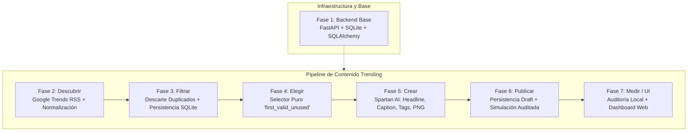

# Documentación Técnica — Sistema Trending para Instagram

Bienvenido al centro de documentación técnica y arquitectónica del **Sistema Trending para Instagram**.

Este repositorio documenta un sistema integral y modular desarrollado con **Python 3.14.5 + FastAPI + SQLAlchemy + SQLite**, diseñado originalmente para coordinar el trabajo desacoplado de hasta 7 participantes mediante contratos tipados y outputs JSON versionados.

---

## 🗺️ Mapa de la Documentación

```text
docs/
├── README.md                          <-- (Este índice general)
├── DOCUMENTATION_AUDIT.md             <-- Informe de auditoría, trazabilidad y estado
├── architecture/                      <-- Arquitectura del sistema y modelo de datos
│   ├── overview.md                    <-- Principios de diseño, stack y visión global
│   ├── components.md                  <-- Capas del backend, responsabilidades y reglas
│   ├── data-flow.md                   <-- Diagramas de flujo y ciclo de vida del pipeline
│   └── database.md                    <-- Esquema relacional SQLite, índices y modelos ORM
├── adr/                               <-- Architecture Decision Records (formato MADR)
│   ├── README.md                      <-- Índice de ADRs, estados y matriz de decisiones
│   ├── ADR-0001-fastapi-backend.md
│   ├── ADR-0002-layered-architecture.md
│   ├── ADR-0003-sqlite-sqlalchemy.md
│   ├── ADR-0004-pydantic-contracts.md
│   ├── ADR-0005-versioned-json-outputs.md
│   ├── ADR-0006-participant-isolation-admin-fallback.md
│   ├── ADR-0007-trends-rss-fallback.md
│   ├── ADR-0008-duplicate-detection-idempotency.md
│   ├── ADR-0009-pure-topic-selection.md
│   ├── ADR-0010-spartan-ai-provider.md
│   ├── ADR-0011-local-asset-storage.md
│   ├── ADR-0012-two-step-publication.md
│   ├── ADR-0013-local-audit-metrics.md
│   ├── ADR-0014-dual-pipeline-state.md
│   ├── ADR-0015-cooperative-request-cancellation.md
│   └── ADR-0016-vanilla-web-frontend.md
├── phases/                            <-- Especificación funcional y técnica por fase
│   ├── phase-01-backend.md            <-- Base FastAPI, base de datos y repositorios
│   ├── phase-02-discovery.md          <-- Búsqueda y normalización de Google Trends
│   ├── phase-03-duplicates.md         <-- Filtrado de duplicados y persistencia atómica
│   ├── phase-04-selection.md          <-- Selector puro y reutilización de temas
│   ├── phase-05-ai.md                 <-- Generación de texto e imágenes vía Spartan
│   ├── phase-06-publication.md        <-- Persistencia draft y simulación auditada
│   └── phase-07-metrics-ui.md         <-- Auditoría de calidad y dashboard interactivo
├── api/
│   └── endpoints.md                   <-- Catálogo completo de endpoints REST
├── operations/                        <-- Guías operativas y de despliegue local
│   ├── installation.md                <-- Instalación en macOS, Linux y Windows
│   ├── configuration.md               <-- Variables de entorno y Spartan Provider
│   └── troubleshooting.md             <-- Resolución de problemas comunes
└── [Documentos Históricos]
    ├── ARQUITECTURA_Y_NORMAS.md       <-- Contrato canónico original de trabajo
    ├── PLAN_COMPLETO.md               <-- Plan funcional original del proyecto
    ├── windows-setup-guide.md         <-- Guía paso a paso para entornos Windows
    └── exposure-participant-*.md      <-- Guías de exposición rápida por participante
```

---

## 🧭 Flujo General del Sistema

El pipeline se compone de **6 fases de procesamiento ordenadas**, alimentadas por una fase base (Fase 1) y orquestadas de forma reactiva o por pasos:



---

## 📊 Matriz Rápida de Trazabilidad

| Fase | Responsable | Servicio Principal | Contrato de Salida | Pruebas Automatizadas | ADR Principal |
|---|---|---|---|---|---|
| **1** | Backend Base | [connection.py](file:///Users/luis/desktop/PROYECTOS/trending/python_backend/database/connection.py) | Endpoints REST | [test_python_backend.py](file:///Users/luis/desktop/PROYECTOS/trending/tests/test_python_backend.py) | [ADR-0001](file:///Users/luis/desktop/PROYECTOS/trending/docs/adr/ADR-0001-fastapi-backend.md), [ADR-0002](file:///Users/luis/desktop/PROYECTOS/trending/docs/adr/ADR-0002-layered-architecture.md) |
| **2** | Participante 2 | [trends_service.py](file:///Users/luis/desktop/PROYECTOS/trending/python_backend/services/trends/trends_service.py) | `trends_v1_{id}.json` | [test_trends_service.py](file:///Users/luis/desktop/PROYECTOS/trending/tests/test_trends_service.py) | [ADR-0007](file:///Users/luis/desktop/PROYECTOS/trending/docs/adr/ADR-0007-trends-rss-fallback.md) |
| **3** | Participante 3 | [duplicates_service.py](file:///Users/luis/desktop/PROYECTOS/trending/python_backend/services/duplicates/duplicates_service.py) | `duplicates_v1_{id}.json` | [test_duplicates_service.py](file:///Users/luis/desktop/PROYECTOS/trending/tests/test_duplicates_service.py) | [ADR-0008](file:///Users/luis/desktop/PROYECTOS/trending/docs/adr/ADR-0008-duplicate-detection-idempotency.md) |
| **4** | Participante 4 | [topic_selector_service.py](file:///Users/luis/desktop/PROYECTOS/trending/python_backend/services/topic_selector/topic_selector_service.py) | `topic_selector_v1_{id}.json` | [test_topic_selector_service.py](file:///Users/luis/desktop/PROYECTOS/trending/tests/test_topic_selector_service.py) | [ADR-0009](file:///Users/luis/desktop/PROYECTOS/trending/docs/adr/ADR-0009-pure-topic-selection.md) |
| **5** | Participante 5 | [ai_service.py](file:///Users/luis/desktop/PROYECTOS/trending/python_backend/services/ai/ai_service.py) | `ai_v1_{id}.json` + PNG | [test_ai_service.py](file:///Users/luis/desktop/PROYECTOS/trending/tests/test_ai_service.py) | [ADR-0010](file:///Users/luis/desktop/PROYECTOS/trending/docs/adr/ADR-0010-spartan-ai-provider.md), [ADR-0011](file:///Users/luis/desktop/PROYECTOS/trending/docs/adr/ADR-0011-local-asset-storage.md) |
| **6** | Participante 6 | [instagram_service.py](file:///Users/luis/desktop/PROYECTOS/trending/python_backend/services/instagram/instagram_service.py) | `instagram_v1_{id}.json` | [test_instagram_service.py](file:///Users/luis/desktop/PROYECTOS/trending/tests/test_instagram_service.py) | [ADR-0012](file:///Users/luis/desktop/PROYECTOS/trending/docs/adr/ADR-0012-two-step-publication.md) |
| **7** | Participante 7 | [metrics_service.py](file:///Users/luis/desktop/PROYECTOS/trending/python_backend/services/metrics/metrics_service.py) | `metrics_v1_{id}.json` | [test_metrics_service.py](file:///Users/luis/desktop/PROYECTOS/trending/tests/test_metrics_service.py) | [ADR-0013](file:///Users/luis/desktop/PROYECTOS/trending/docs/adr/ADR-0013-local-audit-metrics.md), [ADR-0016](file:///Users/luis/desktop/PROYECTOS/trending/docs/adr/ADR-0016-vanilla-web-frontend.md) |

---

## 📌 Principios de Auditoría y Verificación

1. **Evidencia estricta:** Todas las afirmaciones técnicas corresponden al código verificado en el commit [`ba982b8`](file:///Users/luis/desktop/PROYECTOS/trending).
2. **Distinción de estado operacional:**
   * **Implementado y Probado:** Funcionalidad con código activo y cobertura en tests automáticos.
   * **Simulado / Local:** Operaciones que imitan servicios externos sin conexión remota (p. ej. Publicación en Instagram).
   * **Pendiente de confirmación:** Decisiones donde se conoce el diseño implementado pero no existe acta escrita sobre la motivación original del cambio (p. ej. sustitución de Astro por frontend Vanilla).
3. **Inmutabilidad histórica:** Los documentos fundacionales del proyecto ([`docs/PLAN_COMPLETO.md`](file:///Users/luis/desktop/PROYECTOS/trending/docs/PLAN_COMPLETO.md) y [`CONTROL_CAMBIOS.md`](file:///Users/luis/desktop/PROYECTOS/trending/CONTROL_CAMBIOS.md)) se preservan intactos para permitir reconstruir la genealogía del software.
