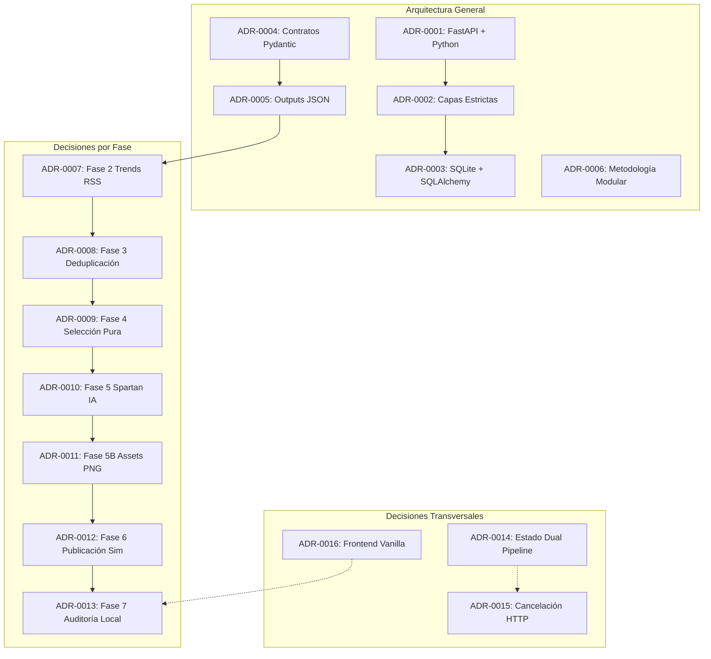

# Architecture Decision Records (ADRs)

Este directorio contiene el registro formal de las decisiones arquitectónicas del **Sistema Trending para Instagram**, estructurado bajo el formato **MADR (Markdown Architectural Decision Records)** adaptado.

Cada ADR describe el problema técnico, la decisión adoptada, su justificación, consecuencias y la evidencia verificable en código, pruebas o documentación previa.

---

## 📋 Estados de Decisión

* **Accepted:** Decisión confirmada con evidencia directa en código fuente, pruebas automatizadas y documentación histórica.
* **Proposed:** Decisión documentada basada en inferencia técnica sólida del código pero cuya motivación o aprobación final del desarrollador está pendiente de ratificación.
* **Deprecated:** Decisión que dejó de estar en vigor pero se conserva por trazabilidad histórica.
* **Superseded:** Decisión reemplazada formalmente por un ADR posterior.

---

## 🗂️ Índice General de ADRs

| Identificador | Título | Estado | Fase / Ámbito | Evidencia Primaria |
|---|---|---|---|---|
| [ADR-0001](file:///Users/luis/desktop/PROYECTOS/trending/docs/adr/ADR-0001-fastapi-backend.md) | Adopción de Python 3.14.5 y FastAPI como framework central | **Accepted** | General / Fase 1 | [main.py](file:///Users/luis/desktop/PROYECTOS/trending/python_backend/main.py), [.python-version](file:///Users/luis/desktop/PROYECTOS/trending/.python-version) |
| [ADR-0002](file:///Users/luis/desktop/PROYECTOS/trending/docs/adr/ADR-0002-layered-architecture.md) | Arquitectura en capas con responsabilidad única y límites por componente | **Accepted** | General / Fase 1 | [ARQUITECTURA_Y_NORMAS.md](file:///Users/luis/desktop/PROYECTOS/trending/docs/ARQUITECTURA_Y_NORMAS.md) |
| [ADR-0003](file:///Users/luis/desktop/PROYECTOS/trending/docs/adr/ADR-0003-sqlite-sqlalchemy.md) | Persistencia relacional con SQLite y SQLAlchemy ORM en modo síncrono | **Accepted** | Persistencia / Fase 1 | [connection.py](file:///Users/luis/desktop/PROYECTOS/trending/python_backend/database/connection.py), [schema.sql](file:///Users/luis/desktop/PROYECTOS/trending/python_backend/database/schema.sql) |
| [ADR-0004](file:///Users/luis/desktop/PROYECTOS/trending/docs/adr/ADR-0004-pydantic-contracts.md) | Validación tipada de entradas y salidas mediante contratos Pydantic v2 | **Accepted** | General / Schemas | [output_schema.py](file:///Users/luis/desktop/PROYECTOS/trending/python_backend/schemas/output_schema.py) |
| [ADR-0005](file:///Users/luis/desktop/PROYECTOS/trending/docs/adr/ADR-0005-versioned-json-outputs.md) | Comunicación inter-fase basada en outputs JSON versionados y desacoplados | **Accepted** | General / Pipeline | [validate_output.py](file:///Users/luis/desktop/PROYECTOS/trending/tools/validate_output.py), [output/](file:///Users/luis/desktop/PROYECTOS/trending/output) |
| [ADR-0006](file:///Users/luis/desktop/PROYECTOS/trending/docs/adr/ADR-0006-participant-isolation-admin-fallback.md) | Organización modular por participantes y regla de intervención administrativa | **Accepted** | Metodología / Fases | [CONTROL_CAMBIOS.md](file:///Users/luis/desktop/PROYECTOS/trending/CONTROL_CAMBIOS.md#L72-L114) |
| [ADR-0007](file:///Users/luis/desktop/PROYECTOS/trending/docs/adr/ADR-0007-trends-rss-fallback.md) | Ingesta de tendencias vía Google Trends RSS con fallback determinístico | **Accepted** | Fase 2 (Descubrir) | [trends_service.py](file:///Users/luis/desktop/PROYECTOS/trending/python_backend/services/trends/trends_service.py) |
| [ADR-0008](file:///Users/luis/desktop/PROYECTOS/trending/docs/adr/ADR-0008-duplicate-detection-idempotency.md) | Deduplicación por `normalized_title` y persistencia atómica en SQLite | **Accepted** | Fase 3 (Filtrar) | [duplicates_service.py](file:///Users/luis/desktop/PROYECTOS/trending/python_backend/services/duplicates/duplicates_service.py) |
| [ADR-0009](file:///Users/luis/desktop/PROYECTOS/trending/docs/adr/ADR-0009-pure-topic-selection.md) | Selección determinística pura de tema postergando la mutación de estado | **Accepted** | Fase 4 (Elegir) | [topic_selector_service.py](file:///Users/luis/desktop/PROYECTOS/trending/python_backend/services/topic_selector/topic_selector_service.py) |
| [ADR-0010](file:///Users/luis/desktop/PROYECTOS/trending/docs/adr/ADR-0010-spartan-ai-provider.md) | Generación de contenido con Spartan Provider HTTP, fallback y dry-run | **Accepted** | Fase 5 (Crear) | [ai_service.py](file:///Users/luis/desktop/PROYECTOS/trending/python_backend/services/ai/ai_service.py), [.env.example](file:///Users/luis/desktop/PROYECTOS/trending/.env.example) |
| [ADR-0011](file:///Users/luis/desktop/PROYECTOS/trending/docs/adr/ADR-0011-local-asset-storage.md) | Almacenamiento local y exposición estática de imágenes en `output/.../assets/` | **Accepted** | Fase 5B / Assets | [ai_service.py](file:///Users/luis/desktop/PROYECTOS/trending/python_backend/services/ai/ai_service.py#L387), [main.py](file:///Users/luis/desktop/PROYECTOS/trending/python_backend/main.py#L33) |
| [ADR-0012](file:///Users/luis/desktop/PROYECTOS/trending/docs/adr/ADR-0012-two-step-publication.md) | Publicación en dos tiempos: persistencia como `draft` y simulación auditada | **Accepted** | Fase 6 (Publicar) | [instagram_service.py](file:///Users/luis/desktop/PROYECTOS/trending/python_backend/services/instagram/instagram_service.py) |
| [ADR-0013](file:///Users/luis/desktop/PROYECTOS/trending/docs/adr/ADR-0013-local-audit-metrics.md) | Medición y scoring de calidad local en lugar de métricas remotas de red social | **Accepted** | Fase 7 (Medir) | [metrics_service.py](file:///Users/luis/desktop/PROYECTOS/trending/python_backend/services/metrics/metrics_service.py) |
| [ADR-0014](file:///Users/luis/desktop/PROYECTOS/trending/docs/adr/ADR-0014-dual-pipeline-state.md) | Persistencia dual de estado: `pipeline_state.json` y tabla relacional `pipeline_runs` | **Accepted** | Transversal | [pipeline_state_service.py](file:///Users/luis/desktop/PROYECTOS/trending/python_backend/services/pipeline/pipeline_state_service.py), [pipeline_history_service.py](file:///Users/luis/desktop/PROYECTOS/trending/python_backend/services/pipeline/pipeline_history_service.py) |
| [ADR-0015](file:///Users/luis/desktop/PROYECTOS/trending/docs/adr/ADR-0015-cooperative-request-cancellation.md) | Cancelación cooperativa de peticiones HTTP en vuelo (`pipeline_cancel_service`) | **Accepted** | Transversal | [pipeline_cancel_service.py](file:///Users/luis/desktop/PROYECTOS/trending/python_backend/services/pipeline/pipeline_cancel_service.py) |
| [ADR-0016](file:///Users/luis/desktop/PROYECTOS/trending/docs/adr/ADR-0016-vanilla-web-frontend.md) | Adopción de Frontend Vanilla (HTML/CSS/JS) y descarte del stack Astro + Tailwind | **Proposed** | Frontend / UX | [frontend/index.html](file:///Users/luis/desktop/PROYECTOS/trending/frontend/index.html), [PLAN_COMPLETO.md](file:///Users/luis/desktop/PROYECTOS/trending/docs/PLAN_COMPLETO.md#L16) |

---

## 🏛️ Matriz de Relación por Fase

---

## 🔍 Estructura Canónica de cada ADR

Cada registro MADR en esta carpeta sigue estrictamente esta estructura:

1. **Estado:** Accepted, Proposed, Deprecated o Superseded.
2. **Contexto:** Problema funcional, restricciones técnicas y antecedentes.
3. **Decisión:** Elección arquitectónica tomada.
4. **Justificación:** Motivos comprobables de diseño.
5. **Alternativas consideradas:** Solo las respaldadas por evidencia de código o historial.
6. **Consecuencias positivas:** Ventajas operativas y de desarrollo.
7. **Consecuencias negativas:** Trade-offs o limitaciones asumidas.
8. **Componentes afectados:** Archivos, clases y tablas involucradas.
9. **Evidencias:** Enlaces directos a código fuente, tests y commits.
10. **Trazabilidad:** Fase correspondiente, fechas y ADRs relacionados.
11. **Observaciones:** Certezas o aspectos pendientes de confirmación.
