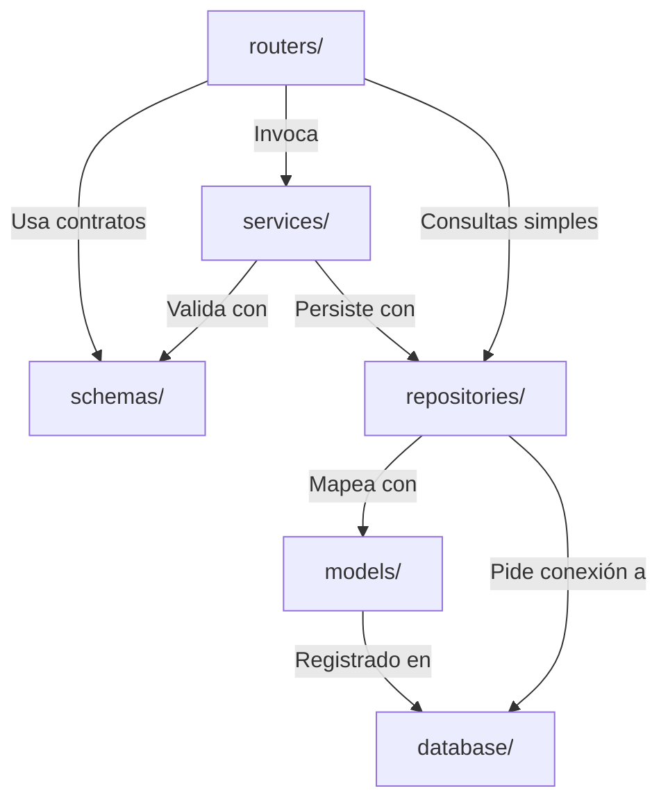

# Componentes y Organización de Capas

Este documento detalla la estructura modular interna del backend en `python_backend/`, definiendo las responsabilidades de cada capa, sus restricciones arquitectónicas y las reglas de interacción.

---

## 1. Organización en Capas del Backend

```text
python_backend/
├── main.py              <-- Fábrica de la app FastAPI, CORS, middlewares y montajes estáticos
├── database/            <-- Configuración del motor SQLite, sesiones y esquema DDL
├── models/              <-- Entidades declarativas de SQLAlchemy (ORM)
├── schemas/             <-- Contratos de validación tipados con Pydantic v2
├── repositories/        <-- Consultas, inserciones y actualizaciones en base de datos
├── services/            <-- Lógica pura de negocio de las fases y orquestación
└── routers/             <-- Endpoints HTTP, mapeo de parámetros y códigos de estado
```

---

## 2. Detalle de Responsabilidades por Capa

### 2.1. `routers/` (Transporte y API HTTP)
* **Responsabilidad:** Recibir peticiones HTTP, desencadenar la validación de schemas de Pydantic, invocar a los servicios correspondientes y retornar respuestas JSON estructuradas con los códigos de estado HTTP apropiados (`200 OK`, `201 Created`, `400 Bad Request`, `404 Not Found`, `422 Unprocessable Entity`).
* **Reglas estrictas:**
  - Prohibido escribir sentencias SQL o interactuar directamente con el motor de SQLAlchemy.
  - Prohibido implementar lógica pesada de negocio o algoritmos de filtrado.
  - Traducir excepciones de dominio (`ValueError`, `RuntimeError`, `InstagramServiceError`) a respuestas JSON con `status_code` correspondiente.
* **Módulos:**
  - [`health_router.py`](file:///Users/luis/desktop/PROYECTOS/trending/python_backend/routers/health_router.py): Chequeo de salud del servicio (`/api/health`).
  - [`topics_router.py`](file:///Users/luis/desktop/PROYECTOS/trending/python_backend/routers/topics_router.py): CRUD y listado de temas (`/api/topics`).
  - [`posts_router.py`](file:///Users/luis/desktop/PROYECTOS/trending/python_backend/routers/posts_router.py): Gestión de posts, auditoría y simulación (`/api/posts`).
  - [`logs_router.py`](file:///Users/luis/desktop/PROYECTOS/trending/python_backend/routers/logs_router.py): Consulta de logs de publicación (`/api/logs`).
  - [`ai_router.py`](file:///Users/luis/desktop/PROYECTOS/trending/python_backend/routers/ai_router.py): Estado y conexión a Spartan Provider (`/api/ai/providers`).
  - [`pipeline_router.py`](file:///Users/luis/desktop/PROYECTOS/trending/python_backend/routers/pipeline_router.py): Orquestador central de pasos, ejecuciones batch, cancelación e historial (`/api/pipeline`).

### 2.2. `schemas/` (Contratos de Datos con Pydantic)
* **Responsabilidad:** Definir las estructuras de datos esperadas tanto para la API REST como para los archivos de intercambio inter-fase.
* **Reglas estrictas:**
  - Prohibido acceder a la base de datos o ejecutar lógica de negocio.
  - Uso estricto de Pydantic v2 (`BaseModel`, `Field`, `Literal`).
* **Módulos:**
  - [`output_schema.py`](file:///Users/luis/desktop/PROYECTOS/trending/python_backend/schemas/output_schema.py): Contrato canónico [`ParticipantOutput`](file:///Users/luis/desktop/PROYECTOS/trending/python_backend/schemas/output_schema.py#L32) (`schema_version="1.0"`, `run_id`, `participant`, `stage`, `status`, `data`, `errors`).
  - [`topic_schema.py`](file:///Users/luis/desktop/PROYECTOS/trending/python_backend/schemas/topic_schema.py): Validación de creación y consulta de temas.
  - [`post_schema.py`](file:///Users/luis/desktop/PROYECTOS/trending/python_backend/schemas/post_schema.py): Validación de posts generados.
  - [`log_schema.py`](file:///Users/luis/desktop/PROYECTOS/trending/python_backend/schemas/log_schema.py): Validación de logs de publicación.

### 2.3. `models/` (Entidades ORM Relacionales)
* **Responsabilidad:** Declarar las tablas, columnas, tipos de datos, valores por defecto e índices en SQLite mediante SQLAlchemy Declarative Base.
* **Reglas estrictas:**
  - Prohibido incluir lógica de negocio o formateo de respuestas web.
  - Uso de sintaxis moderna SQLAlchemy 2.0 (`Mapped`, `mapped_column`, `relationship`).
* **Módulos:**
  - [`topic_model.py`](file:///Users/luis/desktop/PROYECTOS/trending/python_backend/models/topic_model.py): Entidad `TrendingTopic` (tabla `trending_topics`).
  - [`post_model.py`](file:///Users/luis/desktop/PROYECTOS/trending/python_backend/models/post_model.py): Entidad `GeneratedPost` (tabla `generated_posts`).
  - [`log_model.py`](file:///Users/luis/desktop/PROYECTOS/trending/python_backend/models/log_model.py): Entidad `PublicationLog` (tabla `publication_logs`).
  - [`pipeline_run_model.py`](file:///Users/luis/desktop/PROYECTOS/trending/python_backend/models/pipeline_run_model.py): Entidad `PipelineRun` (tabla `pipeline_runs`).

### 2.4. `repositories/` (Acceso a Datos)
* **Responsabilidad:** Encapsular las consultas y mutaciones en base de datos. Hablar directamente con las sesiones de SQLAlchemy.
* **Reglas estrictas:**
  - Manejar transacciones limpias mediante context managers `with get_session() as session:`.
  - Devolver diccionarios primitivos serializables para evitar errores de desprendimiento de sesión (`DetachedInstanceError`) en capas superiores.
* **Módulos:**
  - [`topic_repository.py`](file:///Users/luis/desktop/PROYECTOS/trending/python_backend/repositories/topic_repository.py): Búsqueda por ID, título normalizado, listados y marcado de `used`.
  - [`post_repository.py`](file:///Users/luis/desktop/PROYECTOS/trending/python_backend/repositories/post_repository.py): Creación de posts, búsqueda y actualización de estados (`draft`, `published_simulated`).
  - [`log_repository.py`](file:///Users/luis/desktop/PROYECTOS/trending/python_backend/repositories/log_repository.py): Creación y filtrado de logs por post.

### 2.5. `services/` (Lógica de Negocio y Fases del Pipeline)
* **Responsabilidad:** Implementar las operaciones del dominio. Cada fase del pipeline reside en su subdirectorio aislado.
* **Módulos y Subpaquetes:**
  - [`trends/`](file:///Users/luis/desktop/PROYECTOS/trending/python_backend/services/trends): **Fase 2.** Consulta RSS, parseo XML, sanitización de títulos y fallback determinístico.
  - [`duplicates/`](file:///Users/luis/desktop/PROYECTOS/trending/python_backend/services/duplicates): **Fase 3.** Detección de duplicados internos y en SQLite, y persistencia atómica de temas nuevos.
  - [`topic_selector/`](file:///Users/luis/desktop/PROYECTOS/trending/python_backend/services/topic_selector): **Fase 4.** Selector puro de temas (`first_valid_unused`) y soporte de reutilización manual.
  - [`ai/`](file:///Users/luis/desktop/PROYECTOS/trending/python_backend/services/ai): **Fase 5 y 5B.** Generación de textos e imágenes vía Spartan Provider / DryRun, guardado de PNGs en disco y puente de autenticación OAuth.
  - [`instagram/`](file:///Users/luis/desktop/PROYECTOS/trending/python_backend/services/instagram): **Fase 6A y 6B.** Persistencia de borrador de post y simulación de publicación local auditada.
  - [`metrics/`](file:///Users/luis/desktop/PROYECTOS/trending/python_backend/services/metrics): **Fase 7.** Medición y scoring de calidad local sobre la publicación.
  - [`pipeline/`](file:///Users/luis/desktop/PROYECTOS/trending/python_backend/services/pipeline): **Transversal.** Orquestación del estado en disco (`pipeline_state_service`), persistencia histórica (`pipeline_history_service`) y cancelación cooperativa de sockets en vuelo (`pipeline_cancel_service`).

---

## 3. Matriz de Dependencias entre Capas



* Las dependencias fluyen siempre hacia abajo: `routers -> services -> repositories -> models/database`.
* Las capas inferiores no conocen a las superiores (ej. `models` y `repositories` no conocen a `routers`).
* Los `services` interactúan entre sí únicamente a través de los outputs versionados en disco, garantizando desacoplamiento temporal.
