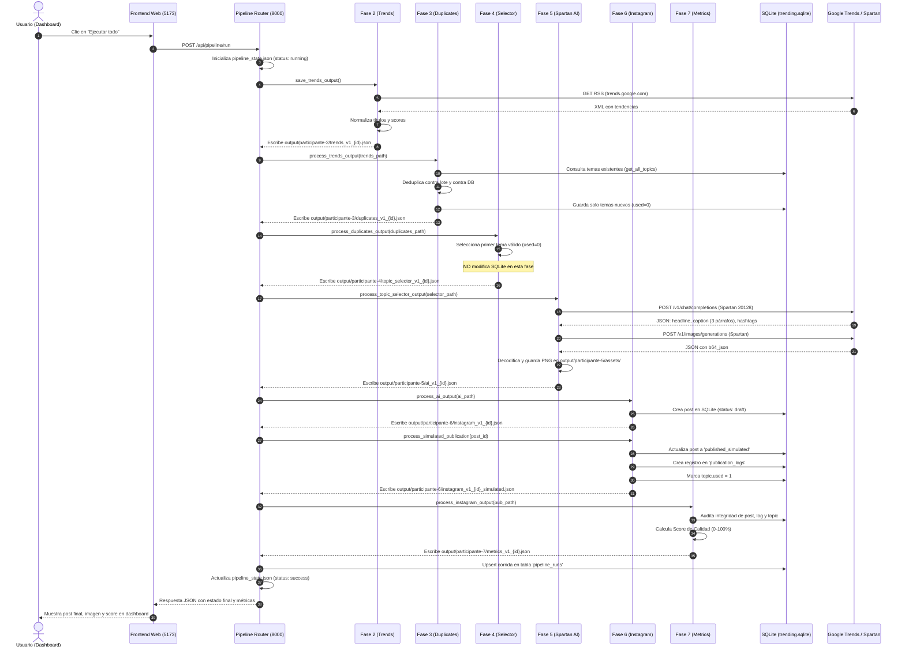
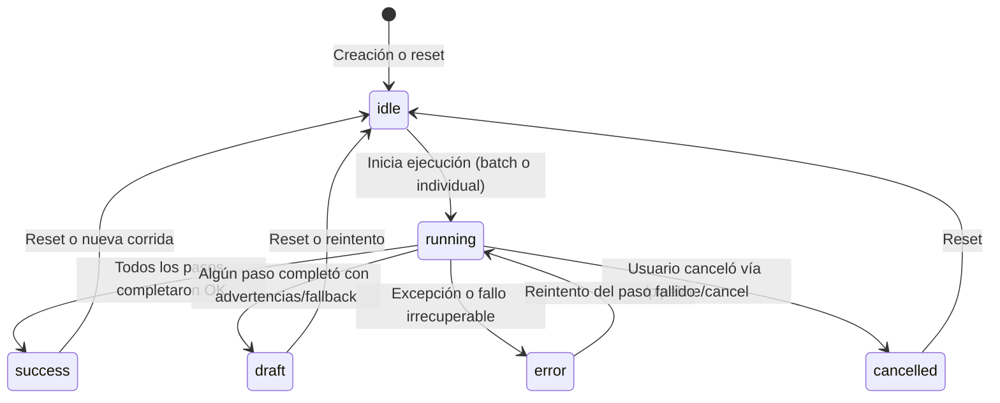
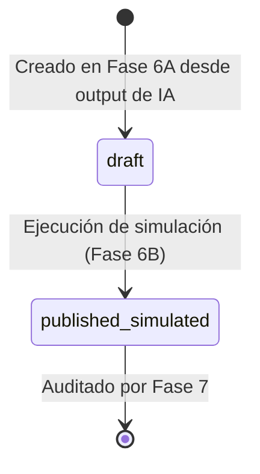

# Flujo de Datos y Ciclo de Vida del Pipeline

Este documento describe cómo se transforman los datos a lo largo de las distintas fases del sistema, los estados por los que transiciona una corrida del pipeline y el ciclo de vida de una publicación.

---

## 1. Diagrama de Secuencia de Ejecución Completa

El siguiente diagrama detalla la interacción entre el Frontend, el Backend FastAPI, los Servicios de Fase, la Base de Datos SQLite y los Servicios Externos:

---

## 2. Estados de una Corrida del Pipeline

El archivo [`output/pipeline_state.json`](file:///Users/luis/desktop/PROYECTOS/trending/output/pipeline_state.json) y la tabla `pipeline_runs` mantienen sincronizado el estado del proceso:

* **`idle`:** El pipeline está en reposo, listo para iniciar una corrida o con un tema preparado para reutilizar.
* **`running`:** Uno o varios pasos están activamente en ejecución.
* **`success`:** La corrida finalizó completamente sin advertencias y con calidad 100%.
* **`draft`:** La corrida completó, pero alguna fase previa recurrió a un fallback determinístico (ej. Google Trends no respondió o Spartan generó texto en modo offline).
* **`error`:** Ocurrió un error grave de validación de contrato o fallo irrecuperable de persistencia.
* **`cancelled`:** La ejecución fue interrumpida cooperativamente a petición del usuario.

---

## 3. Estados de una Publicación (`GeneratedPost`)

A lo largo del pipeline, una publicación pasa por los siguientes estados dentro de SQLite y en los outputs:

1. **`draft`:** El post fue generado por la IA y persistido en `generated_posts`. Contiene `caption`, `image_url` y `hashtags`, pero aún no se ha cerrado la publicación ni se ha marcado el tema como usado.
2. **`published_simulated`:** Se ejecutó `simulate_publication()`. Se verificó que el post tiene caption e imagen, se creó la bitácora en `publication_logs` y se actualizó `topic.used = 1`.
3. *(Futuro)* **`published_instagram`:** Reservado para cuando se incorpore la llamada real a la Graph API de Meta en un release posterior.

---

## 4. Contratos de Datos y Archivos de Salida

Cada paso produce un archivo inmutable que alimenta al paso siguiente:

| Paso Origen | Archivo Producido | Consumidor Directo | Contenido Clave Transferido |
|---|---|---|---|
| **Fase 2** | `output/participante-2/trends_v1_{id}.json` | Fase 3 | Lista de tendencias (`items`) con `title`, `normalized_title`, `score`, `country`. |
| **Fase 3** | `output/participante-3/duplicates_v1_{id}.json` | Fase 4 | Temas deduplicados y guardados (`items`), con sus IDs de SQLite asignados. |
| **Fase 4** | `output/participante-4/topic_selector_v1_{id}.json` | Fase 5 | Objeto único `selected_topic` (`id`, `title`, `normalized_title`, `used=0`). |
| **Fase 5** | `output/participante-5/ai_v1_{id}.json` | Fase 6 | Textos (`headline`, `caption`, `description`, `hashtags`) y ruta a `image_file`. |
| **Fase 5B**| `output/participante-5/assets/ai_v1_{id}.png` | Fase 6 / UI | Archivo físico binario PNG decodificado desde Base64. |
| **Fase 6** | `output/participante-6/instagram_v1_{id}.json` | Fase 7 | Objeto `post` con ID de SQLite, estado (`draft` o `published_simulated`). |
| **Fase 7** | `output/participante-7/metrics_v1_{id}.json` | Dashboard / UI | Diccionario de auditoría técnica con `score` (0-100%) y lista de advertencias. |
