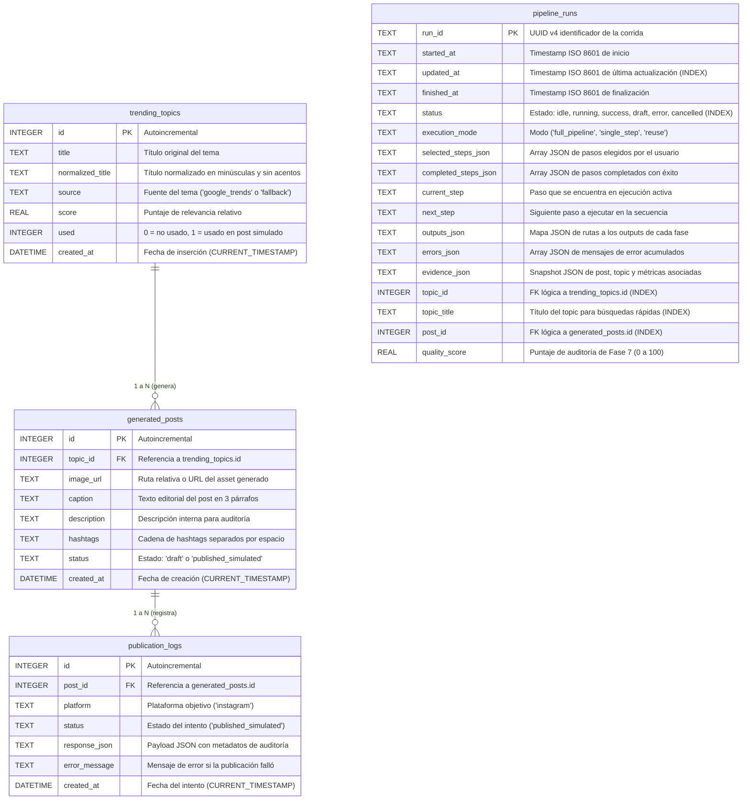

# Base de Datos y Modelo Relacional

Este documento documenta la capa de persistencia relacional en SQLite, el esquema SQL oficial, los modelos declarativos de SQLAlchemy y las políticas de integridad referencial.

---

## 1. Diagrama Entidad-Relación Completo



---

## 2. Definición DDL del Esquema (`schema.sql`)

El archivo canónico de referencia DDL es [`python_backend/database/schema.sql`](file:///Users/luis/desktop/PROYECTOS/trending/python_backend/database/schema.sql):

```sql
CREATE TABLE IF NOT EXISTS trending_topics (
  id INTEGER PRIMARY KEY AUTOINCREMENT,
  title TEXT NOT NULL,
  normalized_title TEXT NOT NULL,
  source TEXT,
  score REAL DEFAULT 0,
  used INTEGER DEFAULT 0,
  created_at DATETIME DEFAULT CURRENT_TIMESTAMP
);

CREATE TABLE IF NOT EXISTS generated_posts (
  id INTEGER PRIMARY KEY AUTOINCREMENT,
  topic_id INTEGER NOT NULL,
  image_url TEXT,
  caption TEXT,
  description TEXT,
  hashtags TEXT,
  status TEXT DEFAULT 'draft',
  created_at DATETIME DEFAULT CURRENT_TIMESTAMP,
  FOREIGN KEY (topic_id) REFERENCES trending_topics (id)
);

CREATE TABLE IF NOT EXISTS publication_logs (
  id INTEGER PRIMARY KEY AUTOINCREMENT,
  post_id INTEGER NOT NULL,
  platform TEXT NOT NULL,
  status TEXT NOT NULL,
  response_json TEXT,
  error_message TEXT,
  created_at DATETIME DEFAULT CURRENT_TIMESTAMP,
  FOREIGN KEY (post_id) REFERENCES generated_posts (id)
);

CREATE TABLE IF NOT EXISTS pipeline_runs (
  run_id TEXT PRIMARY KEY,
  started_at TEXT NOT NULL,
  updated_at TEXT NOT NULL,
  finished_at TEXT,
  status TEXT NOT NULL,
  execution_mode TEXT,
  selected_steps_json TEXT NOT NULL DEFAULT '[]',
  completed_steps_json TEXT NOT NULL DEFAULT '[]',
  current_step TEXT,
  next_step TEXT,
  outputs_json TEXT NOT NULL DEFAULT '{}',
  errors_json TEXT NOT NULL DEFAULT '[]',
  evidence_json TEXT NOT NULL DEFAULT '{}',
  topic_id INTEGER,
  topic_title TEXT,
  post_id INTEGER,
  quality_score REAL
);

-- Índices de rendimiento para consultas de historial y auditoría:
CREATE INDEX IF NOT EXISTS ix_pipeline_runs_updated_at ON pipeline_runs (updated_at);
CREATE INDEX IF NOT EXISTS ix_pipeline_runs_status ON pipeline_runs (status);
CREATE INDEX IF NOT EXISTS ix_pipeline_runs_topic_id ON pipeline_runs (topic_id);
CREATE INDEX IF NOT EXISTS ix_pipeline_runs_topic_title ON pipeline_runs (topic_title);
CREATE INDEX IF NOT EXISTS ix_pipeline_runs_post_id ON pipeline_runs (post_id);
```

---

## 3. Integridad Referencial y Configuración del Motor

En SQLite, la verificación de claves foráneas viene desactivada por defecto para retrocompatibilidad histórica. En este proyecto se activa explícitamente en [`python_backend/database/connection.py`](file:///Users/luis/desktop/PROYECTOS/trending/python_backend/database/connection.py#L40-L45) mediante un listener de eventos de conexión en SQLAlchemy:

```python
@event.listens_for(engine, "connect")
def set_sqlite_pragma(dbapi_connection, connection_record):
    cursor = dbapi_connection.cursor()
    cursor.execute("PRAGMA foreign_keys=ON")
    cursor.close()
```

Esto asegura que:
- No se pueda insertar un post en `generated_posts` con un `topic_id` inexistente.
- No se pueda insertar una bitácora en `publication_logs` con un `post_id` inexistente.
- Los tests detecten inmediatamente cualquier intento de crear relaciones huérfanas arrojando un `IntegrityError`.

---

## 4. Mapeo con Modelos SQLAlchemy y Repositorios

Cada tabla cuenta con su modelo declarativo y su repositorio asociado:

| Tabla | Modelo ORM | Repositorio | Operaciones Principales |
|---|---|---|---|
| `trending_topics` | [`TrendingTopic`](file:///Users/luis/desktop/PROYECTOS/trending/python_backend/models/topic_model.py) | [`topic_repository.py`](file:///Users/luis/desktop/PROYECTOS/trending/python_backend/repositories/topic_repository.py) | `get_all_topics`, `get_topic_by_id`, `create_topic`, `mark_topic_used`. |
| `generated_posts` | [`GeneratedPost`](file:///Users/luis/desktop/PROYECTOS/trending/python_backend/models/post_model.py) | [`post_repository.py`](file:///Users/luis/desktop/PROYECTOS/trending/python_backend/repositories/post_repository.py) | `get_all_posts`, `get_post_by_id`, `create_post`, `update_post_status`. |
| `publication_logs` | [`PublicationLog`](file:///Users/luis/desktop/PROYECTOS/trending/python_backend/models/log_model.py) | [`log_repository.py`](file:///Users/luis/desktop/PROYECTOS/trending/python_backend/repositories/log_repository.py) | `get_all_logs`, `get_logs_by_post_id`, `create_log`. |
| `pipeline_runs` | [`PipelineRun`](file:///Users/luis/desktop/PROYECTOS/trending/python_backend/models/pipeline_run_model.py) | [`pipeline_history_service.py`](file:///Users/luis/desktop/PROYECTOS/trending/python_backend/services/pipeline/pipeline_history_service.py) | `upsert_pipeline_run`, `get_pipeline_run`, `list_pipeline_runs`. |

### Regla de Retorno en Repositorios
Para evitar el clásico error `DetachedInstanceError` de SQLAlchemy (que ocurre cuando un objeto ORM se accede fuera del bloque de sesión `with get_session()`), **todos los repositorios mapean las entidades a diccionarios primitivos de Python antes de cerrar la sesión**:
```python
return {
    "id": topic.id,
    "title": topic.title,
    "normalized_title": topic.normalized_title,
    "source": topic.source,
    "score": topic.score,
    "used": bool(topic.used),
    "created_at": topic.created_at,
}
```
Esto garantiza que los servicios y routers operen con estructuras limpias, seguras para serialización JSON y completamente independientes del estado de la conexión a base de datos.
