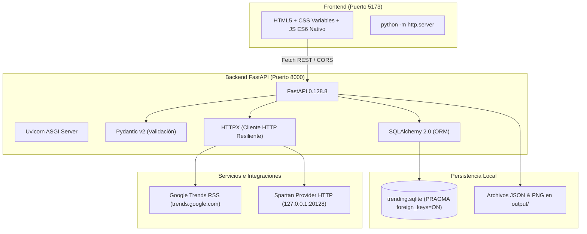

# Visión General de la Arquitectura — Sistema Trending

## 1. Propósito del Sistema

El **Sistema Trending para Instagram** es una solución automatizada diseñada para descubrir temas en tendencia, filtrar duplicados, seleccionar el mejor contenido no utilizado, generar textos e imágenes mediante modelos de inteligencia artificial y simular su publicación y auditoría con fines de control de calidad.

El sistema fue concebido con un doble objetivo:
1. **Funcional:** Automatizar la creación de piezas visuales y editoriales para redes sociales a partir de eventos y tendencias públicas.
2. **Arquitectónico y Pedagógico:** Estructurar un flujo en cascada dividido en **7 roles/fases**, con límites estrictos de edición y contratos tipados que permitan a múltiples desarrolladores (o asistentes de IA) trabajar de forma modular y sin colisiones de código.

---

## 2. Principios Rectores de Diseño

El sistema se rige por las directrices establecidas en [`docs/ARQUITECTURA_Y_NORMAS.md`](file:///Users/luis/desktop/PROYECTOS/trending/docs/ARQUITECTURA_Y_NORMAS.md):

* **Responsabilidad Única Estricta:** Cada capa del backend (routers, schemas, models, repositories, services) tiene una única razón de cambio. Los routers no contienen SQL ni lógica de negocio; los schemas solo validan tipos; los modelos solo declaran la persistencia relacional.
* **Simplicidad y Suficiencia:** Ante dos alternativas viables, siempre se prioriza la opción simple y autosuficiente por sobre abstracciones complejas o sobre-ingeniería innecesaria.
* **Desacoplamiento Basado en Archivos Versionados:** Cada fase consume un archivo JSON auditable de la fase anterior y produce un nuevo archivo JSON versionado bajo el directorio [`output/`](file:///Users/luis/desktop/PROYECTOS/trending/output). Esto permite la ejecución por pasos, la reproducibilidad y la inspección offline.
* **Resiliencia con Degradación Elegante:** Ningún fallo externo (caída de Google Trends, falta de API keys o interrupción del servidor de IA) debe romper el pipeline con excepciones no controladas. El sistema degrada a estados `draft` con datos de fallback determinísticos y registra el error para auditoría.
* **Cero Dependencias de Node.js:** Todo el sistema se ejecuta con el runtime oficial de **Python 3.14.5** y estándares web nativos (HTML/CSS/JS vanilla).

---

## 3. Stack Tecnológico

* **Runtime:** Python `3.14.5` (verificado en [`.python-version`](file:///Users/luis/desktop/PROYECTOS/trending/.python-version)).
* **Framework Backend:** FastAPI `0.128.8` y Uvicorn `0.39.0`. ([ADR-0001](file:///Users/luis/desktop/PROYECTOS/trending/docs/adr/ADR-0001-fastapi-backend.md))
* **Base de Datos Relacional:** SQLite 3 integrado con SQLAlchemy `2.0.44`. ([ADR-0003](file:///Users/luis/desktop/PROYECTOS/trending/docs/adr/ADR-0003-sqlite-sqlalchemy.md))
* **Validación de Datos:** Pydantic `2.13.4`. ([ADR-0004](file:///Users/luis/desktop/PROYECTOS/trending/docs/adr/ADR-0004-pydantic-contracts.md))
* **Cliente HTTP:** HTTPX `0.28.1` con cancelación cooperativa. ([ADR-0015](file:///Users/luis/desktop/PROYECTOS/trending/docs/adr/ADR-0015-cooperative-request-cancellation.md))
* **Frontend:** Vanilla HTML5, CSS y JavaScript moderno sin compiladores ni bundlers. ([ADR-0016](file:///Users/luis/desktop/PROYECTOS/trending/docs/adr/ADR-0016-vanilla-web-frontend.md))
* **Pruebas y Linting:** Pytest `8.4.2` y Ruff `0.15.15`.

---

## 4. Topología de Procesos y Despliegue Local

La aplicación está diseñada para ejecutarse en un entorno de desarrollo local mediante el script unificado [`run.sh`](file:///Users/luis/desktop/PROYECTOS/trending/run.sh) o mediante `make dev`:

1. **Proceso 1 — FastAPI (Backend):** Corre en `http://127.0.0.1:8000` con recarga automática (`--reload`). Expone la API REST, sirve la documentación Swagger en `/docs` y monta los assets estáticos generados en `/assets/participante-5/`.
2. **Proceso 2 — Servidor Web Estático (Frontend):** Corre en `http://127.0.0.1:5173` usando el módulo nativo `http.server` de Python, sirviendo los archivos de [`frontend/`](file:///Users/luis/desktop/PROYECTOS/trending/frontend).
3. **Proceso 3 — Spartan Gateway (Auxiliar Externo):** Se ejecuta de forma independiente en `http://127.0.0.1:20128` para atender las peticiones de inferencia de lenguaje (`gpt-5`) y generación de imágenes si la variable `AI_DRY_RUN` está en `false`.

---

## 5. Decisiones Arquitectónicas Relacionadas

* [ADR-0001: Adopción de Python 3.14.5 y FastAPI como framework central](file:///Users/luis/desktop/PROYECTOS/trending/docs/adr/ADR-0001-fastapi-backend.md)
* [ADR-0002: Arquitectura en capas con responsabilidad única](file:///Users/luis/desktop/PROYECTOS/trending/docs/adr/ADR-0002-layered-architecture.md)
* [ADR-0003: Persistencia relacional con SQLite y SQLAlchemy ORM](file:///Users/luis/desktop/PROYECTOS/trending/docs/adr/ADR-0003-sqlite-sqlalchemy.md)
* [ADR-0005: Comunicación inter-fase basada en outputs JSON versionados](file:///Users/luis/desktop/PROYECTOS/trending/docs/adr/ADR-0005-versioned-json-outputs.md)
* [ADR-0016: Adopción de Frontend Vanilla Web](file:///Users/luis/desktop/PROYECTOS/trending/docs/adr/ADR-0016-vanilla-web-frontend.md)
